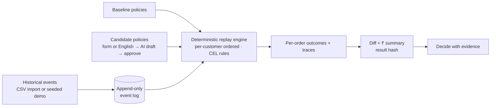

# BranchLab

**Test tomorrow's business policy on yesterday's reality.**

BranchLab replays a D2C brand's real order history (orders, COD/prepaid, deliveries, RTOs, returns) under
its **current** policies and a **proposed** change, then shows exactly which orders would have been
different and by how many rupees, with a clause-level explanation for every order.

> Example question: *"If we had charged a ₹49 COD fee (waived above ₹1,499) and blocked COD above ₹3,000
> last quarter, what would have changed?"*
> Example answer: *"4,931 orders change. +₹2.41L in COD fees. 412 orders blocked: 131 of them actually
> RTO'd (₹32,750 cost avoided), and ₹6.1L of delivered revenue would have been at risk."*

It replays **facts**. It does not predict behaviour change, and it says so on every result.

---

## Run M0 locally

Install Docker with Compose, JDK 21 and Node.js 22. From the project root, run each command in its own terminal.

| Service | Command on Windows |
|---|---|
| PostgreSQL | `docker compose up -d --wait` |
| Spring Boot API | `cd backend`, then `.\mvnw.cmd spring-boot:run` |
| Next.js | `cd frontend`, run `npm ci` once, then `npm run dev` |

On macOS or Linux, use `sh ./mvnw spring-boot:run` in the backend directory.
Open the local URL printed by Next.js (usually [localhost:3000](http://localhost:3000)), choose **Create an account**, and enter a workspace name, email and password.
After signup, the workspace shows dataset and policy counts and recent runs. Sign out and sign back in to return to it.
The API exposes its health at [Actuator health](http://localhost:8080/actuator/health).

The local database uses port 5432 and a Docker volume. `docker compose stop` stops PostgreSQL and preserves the data.
The API accepts `BRANCHLAB_DB_URL` (JDBC), `BRANCHLAB_DB_USER` and `BRANCHLAB_DB_PASSWORD` for a separate database.
The frontend proxies API calls to `BRANCHLAB_API_ORIGIN`, which defaults to `http://127.0.0.1:8080`.

The API generates a local signing key on startup. Set `BRANCHLAB_JWT_SECRET` to a Base64-encoded random key of at least 32 bytes to keep sessions across restarts.
Set `BRANCHLAB_SECURE_COOKIES=true` when serving over HTTPS. Access tokens last 15 minutes and refresh cookies last seven days.

### Verify M0

- **API and database** — Run `.\mvnw.cmd verify` in `backend` with Docker running. Testcontainers starts a separate PostgreSQL instance for the tests.
- **Frontend** — Run `npm run lint` and `npm run build` in `frontend`.
- **Browser** — With the Compose database running and the frontend built, run `npx playwright install chromium` and `npm run test:e2e` in `frontend`. Leave ports 8080 and 3100 free. The test starts both apps and signs up with a unique test email.
- **CI** — GitHub Actions runs these checks on pushes and pull requests.

## One-page summary

| | |
|---|---|
| **Users** | Founders / ops heads of Indian D2C brands (2k–50k orders/month), plus their finance/growth analysts |
| **Pain** | Policy changes such as return windows, return fees, COD fees, COD limits and free-shipping thresholds move margin, but are decided by gut feel; COD RTO costs ~₹180–450 per failed order |
| **Gap** | Backtesting exists for fraud (Lithic, Sift), compliance (Alloy) and pricing on one billing platform (Orb). Nothing exists for everyday commerce policies at SMB scale |
| **MVP** | 3 policy types (Return, COD, Shipping) · seeded demo data + CSV import · Baseline vs up to 3 candidates · ₹ summary, affected orders, per-order traces · deterministic, hash-verified runs · optional AI drafting from plain English |
| **Stack** | Java 21 + Spring Boot 3 · PostgreSQL (events, results, job queue) · CEL rule engine · Next.js + TypeScript + Tailwind · Ollama (optional, local) |
| **Cost** | ₹0 demo target within free-tier limits. Docker Compose locally, Vercel for the frontend, Render for the API, and Neon for PostgreSQL |
| **Acceptance targets** | 100k events replayed in < 10 s · identical result hash with 1 or 8 threads · demo reaches results in < 60 s |

## How it works

## Documents
| # | Doc | What's inside |
|---|---|---|
| 01 | [Research & positioning](docs/01-research.md) | Competitors, market evidence, why D2C, the honesty principle, technical research |
| 02 | [Product spec (PRD)](docs/02-product-spec.md) | Personas, policy types, user stories + acceptance criteria, metrics, risks |
| 03 | [Technical design](docs/03-technical-design.md) | Architecture, data model (DDL), replay engine, determinism, AI flow, API, run lifecycle |
| 04 | [UI & design flow](docs/04-ui-design.md) | Design tokens, information architecture, user journey, every screen, states |
| 05 | [Milestones & build plan](docs/05-milestones.md) | M0–M6 with acceptance criteria, the AI-assistant prompt, the review checklist |

## Build order
M0 Setup → M1 Events & demo data → M2 Policies & CEL → **M3 Replay engine & determinism** → M4 Results UI →
M5 AI drafting & CSV import → M6 Demo mode & deploy.

Start every coding session with the prompt in [05-milestones.md](docs/05-milestones.md#how-to-use-these-docs-with-an-ai-coding-assistant-gptcodexetc).

## Ground rules
- Money is integer **paise**, never floating point.
- The engine core is pure: no clock, randomness, DB or network.
- AI only drafts template parameters; a human always approves. The product works fully without AI.
- No raw customer PII is stored; identifiers are hashed on import.
- Personal project: keep it on a personal GitHub/AI account, separate from employer systems.
