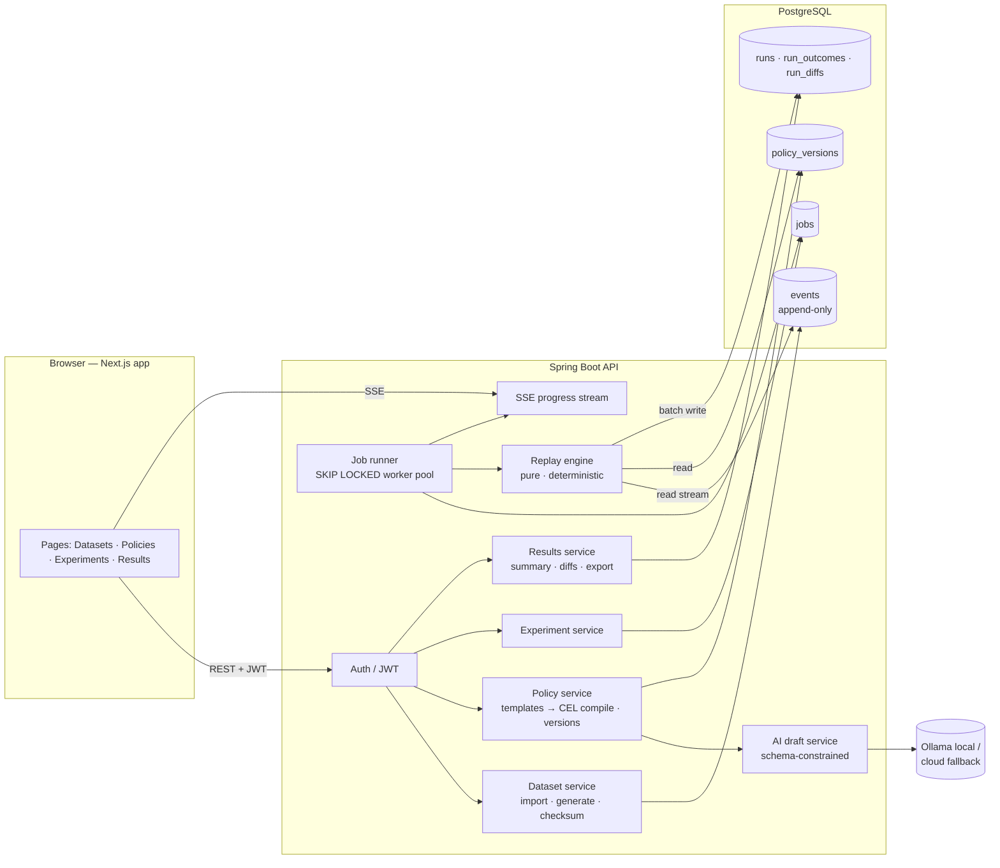
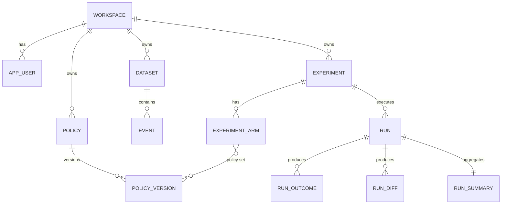
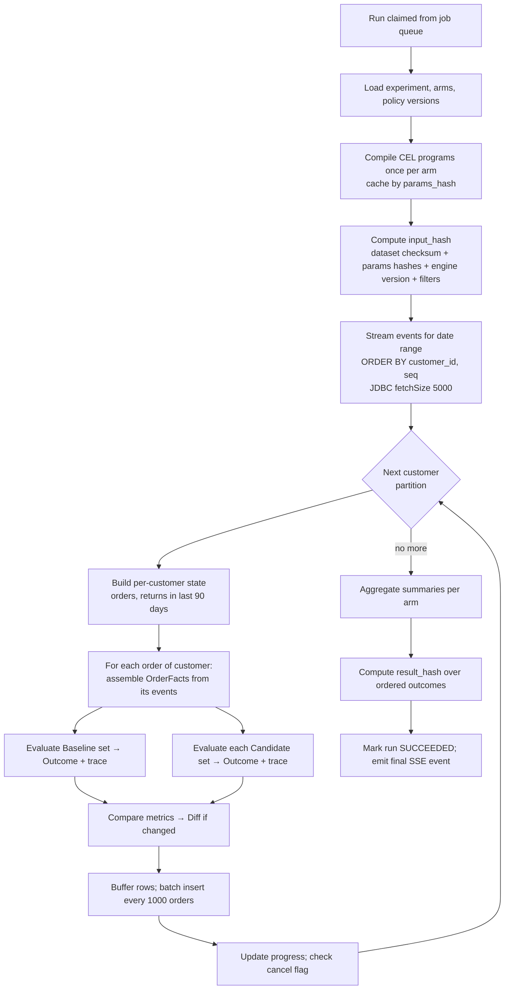
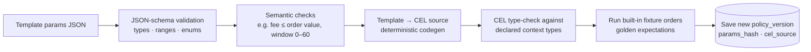
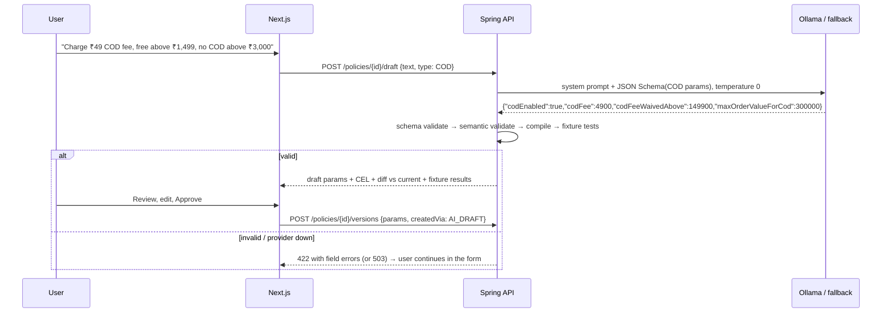
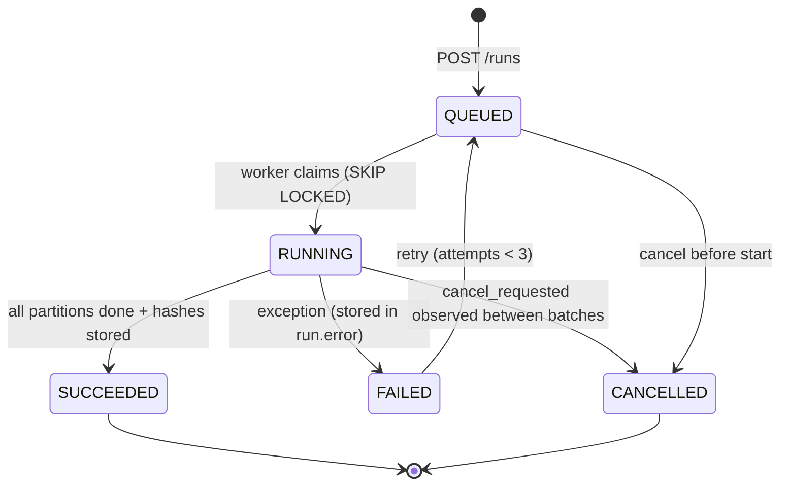

# 03 — Technical Design

> Audience: the engineer (or AI coding agent) building BranchLab.
> Diagrams are Mermaid. They render on GitHub and in VS Code with a Mermaid preview extension.

---

## 1. Stack (all ₹0 for development)

| Layer | Choice | Why |
|---|---|---|
| Backend | **Java 21 + Spring Boot 3**: Web, Validation, Data JPA + JdbcTemplate, Security | Strong typing for the engine, mature, matches the builder's experience |
| Rule evaluation | **CEL**, Google `dev.cel` (Java) | Safe, non-Turing-complete, fast; compile once, evaluate many times |
| Database | **PostgreSQL 16+** | JSONB for event payloads, strong indexing, also used as the job queue |
| Migrations | **Flyway** | Versioned schema |
| Job queue | PostgreSQL table + `SELECT … FOR UPDATE SKIP LOCKED` | No Kafka/Redis needed for the MVP |
| Progress streaming | **Server-Sent Events (SSE)** | One-way progress; simpler than WebSockets |
| Frontend | **Next.js (App Router) + React + TypeScript + Tailwind CSS** | Fast UI building, matches the builder's experience |
| Data fetching | TanStack Query | Caching, polling and mutations |
| Tables | TanStack Table | Large paginated tables with filters |
| Charts | Recharts (or hand-rolled SVG) | Simple bar/waterfall charts |
| Forms | React Hook Form + Zod | Same schemas validate client-side |
| AI (optional) | **Ollama** locally (e.g. a Qwen/Llama instruct model) with JSON-schema `format`; cloud fallback via an OpenAI-compatible API (e.g. Gemini free tier) for the hosted demo | ₹0 locally; the engine never depends on AI |
| Auth | JWT (access + refresh), BCrypt | Simple and stateless |
| Tests | JUnit 5, Testcontainers (Postgres), AssertJ; Playwright for UI smoke tests | Real DB in tests; replay determinism tests |
| Local infra | Docker Compose: postgres, (optional) ollama | One command to start |
| Hosting (demo) | Next.js on Vercel Hobby, Spring Boot on a Render free web service, PostgreSQL on Neon Free | Cold starts are acceptable for the personal demo |

---

## 2. System architecture



### Module boundaries (backend packages)
```
com.branchlab
├── auth          // users, JWT, workspace membership
├── dataset       // CSV import, column mapping, synthetic generator, checksum
├── event         // event schema, upcasters, event reader (streaming)
├── policy        // policy types (templates), versioning, CEL compiler, sample-order test
├── ai            // drafting: prompt, JSON schema, provider failover, validation
├── experiment    // experiment definitions, policy sets
├── engine        // replay engine (no Spring dependencies inside core)
├── job           // job queue, worker pool, cancellation, progress
├── result        // aggregation, diffs, export, result hash
└── common        // money (paise), errors, pagination
```
**Rule:** `engine` core is plain Java with no Spring, DB or clock access. It receives events plus compiled policies and returns outcomes. This is what makes it deterministic and unit-testable.

---

## 3. Data model



### DDL (Flyway V1, abridged; types are the contract)
```sql
create table workspace (
  id uuid primary key, name text not null,
  rto_cost_paise bigint not null default 25000,      -- ₹250 default, editable
  created_at timestamptz not null default now()
);

create table app_user (
  id uuid primary key, workspace_id uuid not null references workspace(id),
  email text not null unique, password_hash text not null,
  role text not null check (role in ('OWNER','VIEWER')),
  created_at timestamptz not null default now()
);

create table dataset (
  id uuid primary key, workspace_id uuid not null references workspace(id),
  name text not null, source text not null check (source in ('GENERATED','CSV')),
  seed bigint,                                  -- for GENERATED
  status text not null check (status in ('IMPORTING','READY','FAILED')),
  event_count int not null default 0,
  checksum text,                                -- sha256 over ordered events
  period_from date, period_to date,
  created_at timestamptz not null default now()
);

create table event (
  dataset_id uuid not null references dataset(id),
  seq bigint not null,                          -- global order within dataset
  event_id uuid not null,
  type text not null,                           -- ORDER_PLACED, DELIVERED, ...
  schema_version int not null default 1,
  order_id text not null,
  customer_id text not null,                    -- hashed in imports (no raw PII)
  occurred_at timestamptz not null,
  payload jsonb not null,
  primary key (dataset_id, seq)
);
create index event_customer_idx on event (dataset_id, customer_id, seq);
create index event_time_idx on event (dataset_id, occurred_at);

create table policy (
  id uuid primary key, workspace_id uuid not null references workspace(id),
  type text not null check (type in ('RETURN','COD','SHIPPING')),
  name text not null, created_at timestamptz not null default now()
);

create table policy_version (
  id uuid primary key, policy_id uuid not null references policy(id),
  version int not null,
  params jsonb not null,                        -- validated template parameters
  cel_source text not null,                     -- compiled, shown read-only
  params_hash text not null,                    -- sha256(canonical params json)
  created_by uuid references app_user(id),
  created_via text not null check (created_via in ('FORM','AI_DRAFT','ADVANCED')),
  created_at timestamptz not null default now(),
  unique (policy_id, version)
);

create table experiment (
  id uuid primary key, workspace_id uuid not null references workspace(id),
  name text not null, dataset_id uuid not null references dataset(id),
  period_from date not null, period_to date not null,
  filters jsonb not null default '{}',          -- {categories, paymentModes, pincodeTiers}
  created_at timestamptz not null default now()
);

create table experiment_arm (                   -- BASELINE + 1..3 CANDIDATE arms
  id uuid primary key, experiment_id uuid not null references experiment(id),
  label text not null, kind text not null check (kind in ('BASELINE','CANDIDATE')),
  policy_version_ids uuid[] not null            -- one version per policy type
);

create table run (
  id uuid primary key, experiment_id uuid not null references experiment(id),
  status text not null check (status in ('QUEUED','RUNNING','SUCCEEDED','FAILED','CANCELLED')),
  engine_version text not null,
  input_hash text not null,                     -- dataset checksum + arm params hashes + engine version + filters
  result_hash text,                             -- sha256 over ordered outcomes
  events_total int, events_processed int default 0,
  error text, started_at timestamptz, finished_at timestamptz,
  created_at timestamptz not null default now()
);

create table run_outcome (                      -- one row per order per arm
  run_id uuid not null references run(id),
  arm_id uuid not null, order_id text not null,
  metrics jsonb not null,                       -- shippingCharged, codFeeCharged, ...
  trace jsonb not null,                         -- clause-level explanation
  evaluable boolean not null default true,
  primary key (run_id, arm_id, order_id)
);

create table run_diff (                         -- only orders where a candidate differs from baseline
  run_id uuid not null references run(id),
  candidate_arm_id uuid not null, order_id text not null,
  changed_metrics text[] not null,
  delta jsonb not null,                         -- metric -> paise delta
  primary key (run_id, candidate_arm_id, order_id)
);

create table run_summary (
  run_id uuid not null references run(id),
  arm_id uuid not null,
  totals jsonb not null,                        -- aggregated metrics
  affected_orders int not null default 0,
  unevaluable_orders int not null default 0,
  primary key (run_id, arm_id)
);

create table job (
  id uuid primary key, type text not null, ref_id uuid not null,
  status text not null check (status in ('QUEUED','RUNNING','DONE','FAILED','CANCELLED')),
  attempts int not null default 0, locked_at timestamptz, cancel_requested boolean default false,
  created_at timestamptz not null default now()
);
create index job_queue_idx on job (status, created_at);
```

### Event types and payloads (schema_version 1)
| Type | Payload fields |
|---|---|
| `ORDER_PLACED` | items[{sku, category, qty, unitPricePaise}], itemTotalPaise, paymentMode (COD/PREPAID), pincodeTier, isFirstOrder |
| `PAYMENT_CAPTURED` | amountPaise, method |
| `SHIPPED` | courier, shippingCostPaise |
| `DELIVERED` | deliveredAt |
| `RTO` | reason (REFUSED/UNREACHABLE/OTHER) |
| `RETURN_REQUESTED` | items[{sku, qty}], reason |
| `RETURN_RECEIVED` | items[{sku, qty}] |
| `REFUND_ISSUED` | amountPaise |

Money is always **integer paise**, never floating point.

---

## 4. Replay engine (the heart)

### Principles
1. **Pure:** `outcome = f(eventsOfOrder, customerHistory, policySet, workspaceConfig)`. No clock, randomness, network or DB inside `f`.
2. **Ordered:** events are processed by `(customer_id, seq)` within a customer partition, which is required for stateful rules like "max returns per 90 days".
3. **Isolated:** the replay never writes to `event` and never triggers side effects.
4. **Whole-set evaluation:** each arm evaluates its entire policy set together, so rule interactions are captured.
5. **Explainable:** every decision appends a trace entry `{policy, clause, inputs, result}`.
6. **Hashable:** outcomes are serialised canonically (sorted keys, ordered by order_id), then hashed. Same inputs → same `result_hash`.

### Pipeline


### Parallelism
- Partition the work by `hash(customer_id) % N`, using N worker threads (virtual threads in Java 21 are fine).
- Order within each customer is preserved, because one thread owns one customer at a time.
- Outcomes are written in batches. The `result_hash` is computed **after** the run, over outcomes sorted by `(arm_id, order_id)`, so thread scheduling never changes the hash.

### Evaluation context exposed to CEL
```text
order:    { id, itemTotal, paymentMode, pincodeTier, isFirstOrder, items[], placedAt }
delivery: { delivered: bool, deliveredAt, rto: bool }
returnReq:{ requested: bool, requestedAt, items[], daysSinceStart }
customer: { returnsLast90Days, ordersLast90Days }
config:   { rtoCostPaise }
```
Templates compile to CEL such as:
```text
// return eligibility (RETURN policy, windowDays=7, start=DELIVERY, excluded=["sale"])
returnReq.requested && delivery.delivered
  && returnReq.daysSinceStart <= 7
  && !returnReq.items.exists(i, i.category in ["sale"])
  && customer.returnsLast90Days < 2
```
**Dates:** `daysSinceStart` is computed by the engine from event timestamps (in a fixed IST zone), never from "now".

### Unevaluable orders
If a template needs a field that an order's events don't have (for example, no `DELIVERED` or `RTO` event yet), the order is marked `evaluable=false` for that metric, counted in the summary, and shown in the UI. It is **never silently treated as zero**.

### Determinism test (must exist from M3 on)
1. Generate a dataset with a fixed seed, then run experiment X twice, with different thread counts (1 and 8).
2. Assert that both runs produce an identical `result_hash`.
3. Assert that `input_hash` is the same, so the same inputs are recognised.

---

## 5. Policy compilation and validation


- **Codegen must be deterministic:** the same params always give the same CEL text.
- **Advanced mode** (raw CEL) skips template codegen but still requires type-checking plus fixture tests.

---

## 6. AI drafting flow (optional, never required)


**Rules:**
- The LLM only ever outputs **template parameters**, never CEL and never code.
- Provider order: Ollama, then a cloud fallback (if a key is configured), then "AI unavailable". Same failover pattern as Acely.
- Log the prompt, response, provider and latency for each draft, for debugging. Never send customer data to the LLM; only the user's sentence and the schema.

---

## 7. API (REST, JSON, `/api/v1`)

| Method | Path | Purpose |
|---|---|---|
| POST | `/auth/signup`, `/auth/login`, `/auth/refresh` | Auth |
| POST | `/demo/session` | Read-only demo workspace token |
| GET | `/datasets` | List |
| POST | `/datasets/generate` | `{name, seed, months, ordersPerMonth}` → job |
| POST | `/datasets/import` | multipart CSVs + column mapping → job |
| GET | `/datasets/{id}` / `/datasets/{id}/health` | Detail and health stats |
| GET/POST | `/policies` | List / create |
| GET | `/policies/{id}/versions` | Version history |
| POST | `/policies/{id}/versions` | Create a new version (params) |
| POST | `/policies/{id}/draft` | AI draft (does not save) |
| POST | `/policies/test` | `{policyVersionIds or params, sampleOrder}` → outcome + trace |
| GET/POST | `/experiments` | List / create (with arms) |
| POST | `/experiments/{id}/runs` | Start a run → `{runId}` |
| GET | `/runs/{id}` | Status, hashes, timings |
| GET | `/runs/{id}/events` | **SSE** progress stream |
| POST | `/runs/{id}/cancel` | Request cancellation |
| POST | `/runs/{id}/verify` | Re-run and compare `result_hash` |
| GET | `/runs/{id}/summary` | Per-arm totals and deltas |
| GET | `/runs/{id}/diffs?arm=&metric=&page=` | Affected orders (paginated) |
| GET | `/runs/{id}/orders/{orderId}` | Both outcomes + traces + raw events |
| GET | `/runs/{id}/export.csv` | Export |

**Errors:** RFC 7807 problem+json, `{type, title, status, detail, errors[{field, message}]}`.
**Pagination:** `?page=&size=` with `X-Total-Count`.

---

## 8. Run lifecycle


On cancel or failure, partial `run_outcome` rows are deleted in the same transaction that marks the status, so no half-results are ever shown.

---

## 9. Synthetic data generator (demo + tests)

- **Seeded** (`java.util.SplittableRandom(seed)`), so output is identical for the same seed.
- Realistic distributions; these are configurable, and the defaults are informed by the research figures:
  - COD share: 55%.
  - COD RTO rate: 28%; prepaid RTO rate: 3%.
  - Return request rate on delivered orders: 12%, with fashion higher.
  - Item prices: log-normal around ₹900; categories: tops, jeans, ethnic, innerwear, accessories, sale.
  - Delivery lag: 2–7 days; return requests: 0–15 days after delivery (some outside the window, on purpose).
  - Repeat customers: 30% of orders, so stateful return limits actually matter.
- The demo seed is `20261116`, documented in the README.

---

## 10. Security & privacy
- Imports **hash customer identifiers** (`sha256(workspaceSalt + email/phone)`), and no names or addresses are stored. The MVP needs no PII.
- Every query is scoped by `workspace_id` (enforced in the repository layer and tested).
- The demo workspace is **read-only**: a role check on every mutating endpoint.
- Rate limits on auth, AI draft and run creation (per user and per IP).
- The CSV upload size is capped (e.g. 50 MB), with streaming parsing and no full-file load into memory.

## 11. Performance targets (MVP)
| Scenario | Target |
|---|---|
| Generate 10k orders (~60k events) | < 10 s |
| Replay 100k events, 2 arms, 8 threads, local | < 10 s |
| Sample-order policy test | < 200 ms |
| Results summary API | < 300 ms |
| Affected-orders page (50 rows) | < 300 ms |

Benchmark with a fixed seed and publish the numbers in the README.

## 12. Repository layout
```
branchlab/
├── backend/                 # Spring Boot (Gradle or Maven)
│   └── src/main/java/com/branchlab/...
├── frontend/                # Next.js app
├── docs/                    # these specs
├── docker-compose.yml       # postgres (+ optional ollama)
├── .env.example
└── README.md
```

## 13. Observability
- Structured JSON logs with `runId` and `workspaceId` in the MDC.
- Per-run timings: load, compile, replay, aggregate and hash phases, stored on the run.
- Spring Actuator health endpoint for the hosting platform.
