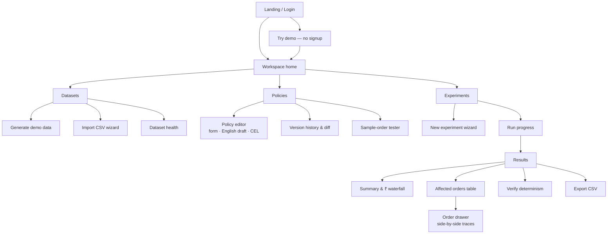

# 04 — UI & Design Flow

> Goal: a non-technical founder reaches a trustworthy answer in under 3 minutes. A recruiter reaches a
> results screen in under 60 seconds.

---

## 1. Design principles
1. **Numbers first, explanations one click away.** Every ₹ figure opens its formula and the orders behind it.
2. **Facts vs estimates are visually different.** Facts use solid styling; anything assumed (post-MVP) uses a dashed border plus an "Estimate" tag.
3. **Diff is the hero.** Baseline and Candidate are always shown in consistent colours, in the same positions.
4. **Never a dead end.** Every empty state has one primary action. Every error says what to do next.
5. **Fast feedback.** Testing a policy on a sample order is instant, so trust is built before running a full replay.

## 2. Design system (tokens)

| Token | Light | Dark | Use |
|---|---|---|---|
| `--bg` | #F7F8FA | #0B0D12 | page |
| `--surface` | #FFFFFF | #12151C | cards |
| `--border` | #E4E7EC | #232836 | dividers |
| `--text` | #101828 | #E6E8EE | primary text |
| `--muted` | #667085 | #9AA1B2 | secondary text |
| `--baseline` | #64748B (slate) | #94A3B8 | Baseline arm everywhere |
| `--candidate` | #6366F1 (indigo) | #818CF8 | Candidate A (B: #0EA5E9, C: #D946EF) |
| `--gain` | #16A34A | #4ADE80 | a positive ₹ delta for the business |
| `--loss` | #DC2626 | #F87171 | a negative ₹ delta |
| `--warn` | #D97706 | #FBBF24 | unevaluable / warnings |

- **Typography:** Inter (UI) and JetBrains Mono (CEL, hashes, IDs). Numbers use `font-variant-numeric: tabular-nums`.
- **Radius:** 10px for cards, 8px for inputs. **Spacing:** a 4px grid.
- **Money:** always `₹1,23,456` (Indian grouping) via `Intl.NumberFormat('en-IN', {style:'currency', currency:'INR'})`. Deltas carry a sign and a colour: `+₹12,400` / `−₹3,050`.
- **Accessibility:** colour is never the only signal (arrows and signs too), a WCAG AA contrast minimum, full keyboard navigation in tables.

## 3. Information architecture



## 4. Primary user journey (first session)

```mermaid
flowchart LR
  A([Open app]) --> B{Has data?}
  B -- No --> C[Generate demo dataset<br/>1 click, seeded]
  B -- Yes --> E
  C --> E[Policies: current = Baseline<br/>prefilled templates]
  E --> F[Duplicate → edit Candidate<br/>form or English draft]
  F --> G[Test on a sample order<br/>instant trace]
  G --> H[New experiment<br/>pick range + arms]
  H --> I[Run → live progress]
  I --> J[Summary: ₹ delta, affected orders]
  J --> K[Drill into an order<br/>why did it change?]
  K --> L{Convinced?}
  L -- Try variant --> F
  L -- Yes --> M[Export / share result]
```



## 5. Screens

### 5.1 Workspace home
- Header: workspace name, dataset selector, user menu.
- Three cards: **Datasets** (count, latest), **Policies** (active baseline set), **Recent runs** (last 5, with status and headline delta).
- Empty state: "Start with demo data: 10,000 realistic D2C orders" → [Generate].

### 5.2 Import CSV wizard (4 steps)
1. **Upload** the orders CSV (required), plus shipments and returns CSVs (optional).
2. **Map columns:** auto-detect common headers, with a dropdown per required field and a live preview of 5 rows.
3. **Validate:** error table (row, column, problem), with "Download error report". Continue is blocked if there are blocking errors.
4. **Confirm:** summary counts → Import (async, with a progress bar).

### 5.3 Dataset health
- KPIs: orders, period, COD %, RTO rate (COD vs prepaid), return rate, average order value.
- A bar chart of orders per week, coloured by outcome (delivered / RTO / returned).
- Warnings list, e.g. "312 orders have no delivery outcome yet. They will be marked unevaluable."

### 5.4 Policy editor
```
┌ COD policy · v3 (Baseline) ───────────────────────── [Version history] ┐
│ ┌ Describe in English ────────────────────────────────────────────┐   │
│ │ "₹49 COD fee, free above ₹1,499, no COD above ₹3,000"  [Draft ✦] │   │
│ └─────────────────────────────────────────────────────────────────┘   │
│ COD enabled          [✓]                                               │
│ COD fee              [₹ 49    ]   waived above [₹ 1,499 ]              │
│ Max order for COD    [₹ 3,000 ]                                        │
│ Blocked pincode tiers [ ] T1 [ ] T2 [ ] T3                             │
│ ── Compiled rule (read-only) ─────────────────────────────────────────│
│ order.paymentMode == "COD" && order.itemTotal <= 300000 ...  (mono)    │
│ ── Test on sample order ─────────────────── [Pick order ▾] [Run test] │
│ Result: COD allowed · fee ₹0 (waived: itemTotal ₹1,850 > ₹1,499)       │
│                                  [Cancel]  [Save as new version v4]    │
└────────────────────────────────────────────────────────────────────────┘
```
- An AI draft fills the form and shows a **change diff** (old → new value, highlighted). Nothing saves until the user clicks Save.
- When AI is unavailable, the draft box shows "AI drafting is offline. Use the form below." The form always works.

### 5.5 New experiment wizard
1. **Question name**, e.g. "COD fee ₹49 vs ₹0".
2. **Data:** dataset, date range (presets: last 30/90/180 days) and filters.
3. **Arms:** Baseline = the current policy set (preselected). Add Candidate A/B/C by picking policy versions per type, or "Duplicate baseline & edit".
4. **Review:** the arms are shown as a parameter table with differences highlighted → [Run experiment].

### 5.6 Run progress
- Progress bar (events processed / total), events per second, elapsed time and phase (Compiling → Replaying → Aggregating → Hashing).
- A Cancel button.
- A live-updating mini-summary once 10% is processed, labelled "partial".

### 5.7 Results: summary
```
┌ COD fee ₹49 vs ₹0 · Jun 1 – Aug 31 · 18,420 orders · ✓ Verified ──────────────┐
│ ⓘ Replay of what actually happened. Does not predict behaviour change.        │
│                                                                                │
│ Net collected        COD fees           Orders affected    Unevaluable         │
│ +₹2,41,619 ▲         +₹2,41,619 ▲       4,931 (26.8%)      212 ⚠              │
│                                                                                │
│ ₹ waterfall: Baseline net → +COD fees → −refund changes → Candidate net        │
│ [████████████████████]  [██]  [ ]  [█████████████████████]                     │
│                                                                                │
│ Breakdown by: [Payment mode ▾]   table: segment | baseline | candidate | Δ    │
│ result hash 9f2c…e81a · engine 0.3.0 · [Re-run & verify] [Export CSV]          │
└────────────────────────────────────────────────────────────────────────────────┘
```
- With multiple candidates: the summary becomes a comparison table (rows = metrics, columns = arms), with the best value per row subtly highlighted.

### 5.8 Results: affected orders
- Columns: order ID, date, payment mode, item total, changed metrics (chips), Δ net.
- Filters: metric changed, payment mode, category, delta range. Sort by |Δ|.
- Clicking a row opens the **order drawer**:
  - **Timeline** of raw events (ordered, with timestamps).
  - **Baseline vs Candidate** outcome columns; differing values highlighted.
  - **Trace:** each clause with its inputs and true/false. The clause that flipped the result is marked "← decided here".

### 5.9 Verify determinism
Re-run with the same inputs, then show both hashes:
- "✓ Identical. Results are reproducible."
- or a red banner with both hashes and a link to the logs.

## 6. Guided tour (demo mode, 4 steps)
1. **Dataset:** "10,000 real-looking orders from a fictional fashion brand."
2. **Policy:** "This is their COD policy today. Here's a proposed ₹49 fee."
3. **Results:** "Exactly 4,931 past orders would have changed, adding ₹2.4L in fees."
4. **Why:** "Open any order to see the exact rule that decided it."

The tour is skippable and remembered in localStorage.

## 7. States checklist (every screen)
| State | Required behaviour |
|---|---|
| Loading | Skeletons matching the final layout (no spinners on full pages) |
| Empty | One sentence + one primary action |
| Error | What happened + what to do + a retry; problem+json `detail` shown |
| Partial | "Partial" tag on live results while a run is in progress |
| Read-only (demo) | Mutating buttons are disabled, with the tooltip "Demo is read-only. Sign up to edit." |
| Offline AI | The draft box is disabled with a reason; the form still works |

## 8. Responsive behaviour
- Desktop first (analysts), fully usable at 1280px.
- Tablet: tables scroll horizontally inside a container, never the whole page.
- Mobile: the results summary and order drawer are readable; editing policies and experiments shows "Best on desktop", but stays possible.
