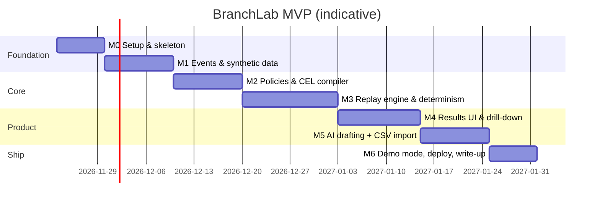

# 05 — Milestones, Acceptance Criteria & Build Plan

> Build strictly in order. Do not start a milestone until the previous one meets every acceptance
> criterion. Rough effort assumes evenings and weekends (~12 h/week).

---

## Timeline overview



---

## M0 — Setup & skeleton
**Build:**
- Monorepo (`backend/`, `frontend/`, `docs/`) and `docker-compose.yml` (Postgres).
- Spring Boot app with Flyway V1 (all tables from 03-technical-design §3), health endpoint, problem+json error handler.
- Auth: signup/login/refresh with JWT + BCrypt; workspace created on signup.
- Next.js app shell: login, workspace home (empty states), API client with auth.

**Acceptance:**
- [ ] `docker compose up` and both apps start with one documented command each.
- [ ] A user can sign up, log in and see an empty workspace home.
- [ ] CI (GitHub Actions) runs backend tests (Testcontainers) and the frontend lint/build.

## M1 — Event model & synthetic data
**Build:**
- Event types and payload records (03 §3), schema_version, an upcaster interface.
- Seeded generator (03 §9) as an async job, with a dataset checksum.
- Dataset list, generate button, and a health page (KPIs + weekly chart).

**Acceptance:**
- [ ] The same seed produces an identical checksum on two separate machines or runs (test).
- [ ] 10k orders are generated in under 10 s locally.
- [ ] The health page matches SQL-computed numbers (test with known seed values).

## M2 — Policies & CEL compiler
**Build:**
- Three templates (RETURN, COD, SHIPPING) with JSON schemas (shared with the frontend through generated TS types or mirrored Zod).
- Template → CEL codegen (deterministic), CEL type-checking, fixture tests.
- Immutable versioning, version history with a parameter diff.
- `/policies/test` sample-order tester with trace output.
- Policy editor UI (04 §5.4), without AI yet.

**Acceptance:**
- [ ] The same params always produce byte-identical CEL (property test).
- [ ] Invalid params return 422 with field-level errors.
- [ ] The sample-order test returns an outcome + trace in under 200 ms.
- [ ] Editing creates v(n+1); v(n) is unchanged (test).

## M3 — Replay engine & determinism (the core)
**Build:**
- An `engine` module in plain Java (no Spring): OrderFacts assembly, per-customer state, multi-arm evaluation, diffing.
- Job queue (SKIP LOCKED), worker pool, cancellation, SSE progress.
- Batch writes, summaries, `input_hash` and `result_hash`.
- Run progress screen.

**Acceptance:**
- [ ] **Determinism:** the same experiment run with 1 thread and with 8 threads produces an identical `result_hash`.
- [ ] Stateful rule correct: a customer's 3rd return in 90 days is ineligible when the max is 2 (unit test with a crafted history).
- [ ] Unevaluable orders are counted, never zeroed (test).
- [ ] 100k events, 2 arms, in under 10 s locally (benchmark logged in the README).
- [ ] Cancel mid-run leaves no partial outcome rows.
- [ ] Replay never writes to the `event` table (test using a DB permission check or repository spy).

## M4 — Results UI & drill-down
**Build:**
- Summary API + screen: cards, ₹ waterfall, breakdown by segment, honesty banner.
- Affected-orders table (server-paginated, filters, sort) + order drawer with the event timeline and side-by-side traces.
- Multi-candidate comparison table, CSV export, "Re-run & verify".

**Acceptance:**
- [ ] Every summary number equals the sum over the exported CSV (test).
- [ ] The order drawer highlights the deciding clause.
- [ ] Verify shows "Identical" for an unchanged dataset and policies.
- [ ] All states from 04 §7 are implemented on the results screens.

## M5 — AI drafting + CSV import
**Build:**
- `/policies/{id}/draft`: Ollama with a JSON-schema `format` at temperature 0, an optional cloud fallback, and validation → compile → fixtures.
- Draft review UI with a change diff; explicit approve.
- CSV import wizard (04 §5.2): streaming parse, mapping, validation report, customer-ID hashing.

**Acceptance:**
- [ ] With Ollama stopped and no fallback key, drafting shows "offline" and the form still works.
- [ ] A golden set of 15 English prompts → 13+ produce valid, correct params (documented eval table).
- [ ] The LLM never receives order or customer data (code review checklist + test on the request body).
- [ ] A 50 MB CSV imports without exceeding a 512 MB heap.

## M6 — Demo mode, deploy & write-up
**Build:**
- `/demo/session` read-only workspace seeded with seed `20261116`, plus the 4-step guided tour.
- Deploy the frontend on Vercel Hobby, the API on a Render free web service and PostgreSQL on Neon Free. Document the required environment variables.
- README: problem, 60-second demo GIF, architecture diagram, determinism proof, benchmark, limitations.
- A short technical write-up: "Deterministic replay for business-policy backtesting".

**Acceptance:**
- [ ] A visitor reaches a results screen within 60 s of opening the demo link.
- [ ] Demo mutations are rejected server-side (test), not only hidden in the UI.
- [ ] The README states the honesty principle and its limitations clearly.

---

## Post-MVP backlog (prioritised)
1. **Assumptions layer:** user-entered behaviour assumptions, rendered as "Estimate" (dashed styling).
2. Shopify / Shiprocket API connectors (scheduled sync).
3. More policy types: first-order discounts, exchange-only, prepaid incentives.
4. Subscription SaaS pack (refund windows, trials, grace periods).
5. Shareable read-only result links.
6. Scheduled re-runs on fresh data, with alerts when a policy's impact drifts.

---

## How to use these docs with an AI coding assistant (GPT/Codex/etc.)

Paste this as the first message of each milestone session:

```text
You are building BranchLab. Read docs/01-research.md, 02-product-spec.md,
03-technical-design.md, 04-ui-design.md and 05-milestones.md in this repo.

Work ONLY on milestone <M#>. Rules:
1. Follow the data model, API paths, event types and money-in-paise rule exactly.
2. The engine core must stay pure Java: no Spring, DB, clock or randomness inside it.
3. Write the tests listed in this milestone's acceptance criteria first, then the code.
4. Do not add features from later milestones or the post-MVP backlog.
5. When done, list each acceptance criterion with how it is satisfied
   (test name or manual step). If anything in the docs is ambiguous, stop and ask.
```

**Review checklist after each milestone (do this yourself, don't trust the agent's summary):**
- [ ] Run the tests locally; read the determinism and money tests yourself.
- [ ] Grep for `LocalDateTime.now(`, `Instant.now(`, `Math.random(` and `new Random(` inside `engine/`. There should be none.
- [ ] Grep for `double`/`float` used for money. There should be none.
- [ ] Every query is scoped by `workspace_id`.
- [ ] Commit with your own name; no AI co-author lines.
